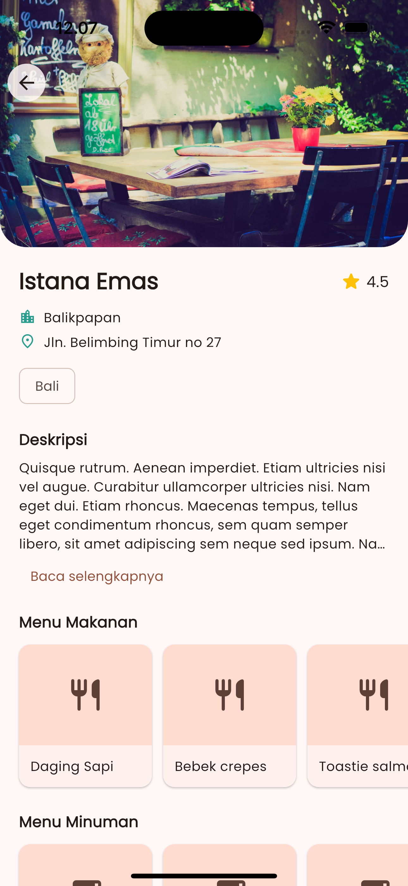
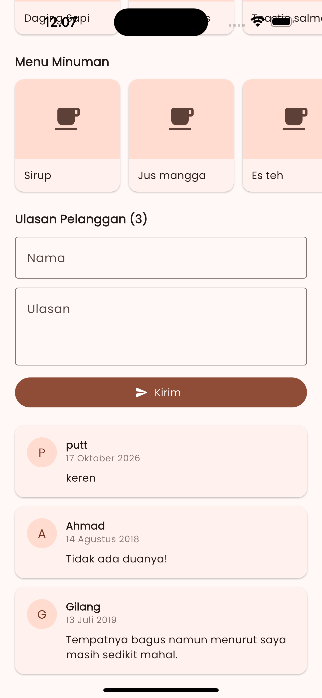

# 🍔 Restaurant App - Dicoding Submission

Aplikasi mobile berbasis **Flutter** untuk menampilkan daftar restoran, melakukan pencarian, melihat detail informasi restoran, serta menambahkan ulasan secara *real-time* menggunakan data dari **Dicoding Restaurant API**. Proyek ini menerapkan arsitektur kode yang bersih (Clean Code) dan manajemen state yang reaktif.

---

## ✨ Fitur Utama (Kriteria & Nilai Tambah)

## 📸 Cuplikan Aplikasi

<table align="center">
  <tr>
    <td align="center"><b>Halaman Utama (Daftar)</b></td>
    <td align="center"><b>Halaman Detail (Atas)</b></td>
    <td align="center"><b>Halaman Detail (Ulasan)</b></td>
  </tr>
  <tr>
    <td></td>
    <td></td>
    <td></td>
  </tr>
</table>


### 🧱 Kriteria Wajib
- **Halaman Daftar Restoran**: Menampilkan nama, gambar, lokasi, dan rating restoran dari API.
- **Halaman Detail Restoran**: Menampilkan informasi lengkap termasuk deskripsi panjang, alamat, serta menu makanan & minuman.
- **Manajemen State**: Menggunakan library **Provider** yang dikombinasikan dengan **Sealed Class** untuk mengelola status data secara aman (`Loading`, `Loaded`, `NoData`, `Error`).
- **Indikator Loading**: Animasi pemuat data (`CircularProgressIndicator`) yang muncul di setiap proses asynchronous API.
- **Kustomisasi Tema**: Mendukung **Light Theme** dan **Dark Theme** kustom dengan jenis font **Poppins** (*Google Fonts*).

### 🌟 Fitur Tambahan (Nilai Bintang 5)
- **Fitur Pencarian**: Kolom pencarian dinamis untuk menyaring restoran berdasarkan nama, kategori, atau menu.
- **Fitur Review**: Menampilkan ulasan pelanggan serta menyediakan *form* untuk menambahkan ulasan baru via HTTP POST.
- **Animasi Hero**: Transisi gambar yang halus dan interaktif saat berpindah dari halaman daftar ke halaman detail.
- **Pesan Error yang Informatif**: Dilengkapi tombol *Retry* (Coba Lagi) jika perangkat kehilangan koneksi internet.

---

## 📂 Struktur Direktori Proyek

Aplikasi ini menggunakan struktur folder modular untuk memisahkan antara logika bisnis, data, dan tampilan (UI):

```text
lib/
├── data/
│   ├── api/  # Service HTTP Client & Custom Exception
│   │   ├── api_exception.dart
│   │   └── api_service.dart
│   └── models/   # Objek Model Data (JSON Parsing)
│       ├── restaurant.dart
│       ├── restaurant_detail.dart
│       └── customer_review.dart
├── providers/  # State Management (ChangeNotifier)
│   ├── restaurant_list_provider.dart
│   └── restaurant_detail_provider.dart
├── static/   # Konfigurasi Tema & Status Sealed Class
│   ├── app_theme.dart
│   └── result_state.dart
├── ui/
│   ├── screens/  # Halaman Utama Aplikasi (List & Detail)
│   │   ├── restaurant_list_screen.dart
│   │   └── restaurant_detail_screen.dart
│   └── widgets/   # Komponen Widget UI yang reusable
│       ├── restaurant_card.dart
│       ├── restaurant_image.dart
│       ├── restaurant_search_field.dart
│       ├── restaurant_detail_content.dart
│       ├── menu_section.dart
│       ├── review_card.dart
│       ├── review_form.dart
│       ├── loading_indicator.dart
│       ├── error_view.dart
│       └── empty_view.dart
└── main.dart

```

---

## 🛠️ Panduan Menjalankan Proyek

Pastikan Anda telah menginstal **Flutter SDK** versi terbaru pada komputer Anda.

### 1. Kloning atau Ekstrak Proyek
Jika Anda menerima proyek ini dalam bentuk ZIP, ekstrak terlebih dahulu ke direktori kerja Anda.

### 2. Instal Dependensi (Packages)
Buka terminal di folder proyek tersebut, lalu jalankan perintah berikut untuk mengunduh semua package yang dibutuhkan (`provider`, `http`, `google_fonts`):
```bash
flutter pub get
```

### 3. Jalankan Aplikasi
Hubungkan emulator (Android/iOS) atau gunakan perangkat asli Anda, kemudian jalankan perintah:
```bash
flutter run
```

### 4. Membersihkan Proyek (Sebelum di-Submit)
Jika Anda ingin mengompres kembali proyek ini untuk dikirimkan ke Dicoding, bersihkan folder `build/` terlebih dahulu dengan perintah:
```bash
flutter clean
```

---

## 🌐 Endpoint API yang Digunakan
Semua data di dalam aplikasi ini bersumber langsung dari **Dicoding Restaurant API**:
- Daftar Restoran: `GET https://dicoding.dev`
- Detail Restoran: `GET https://dicoding.dev{id}`
- Pencarian: `GET https://dicoding.dev{query}`
- Tambah Review: `POST https://dicoding.dev`
