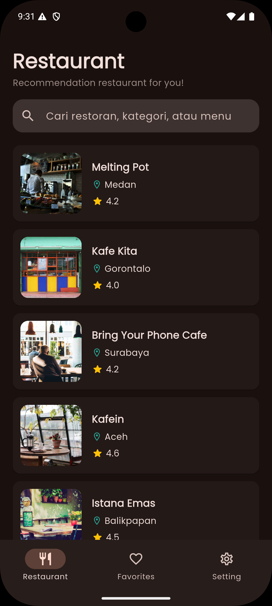
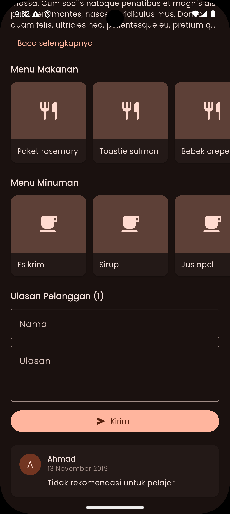
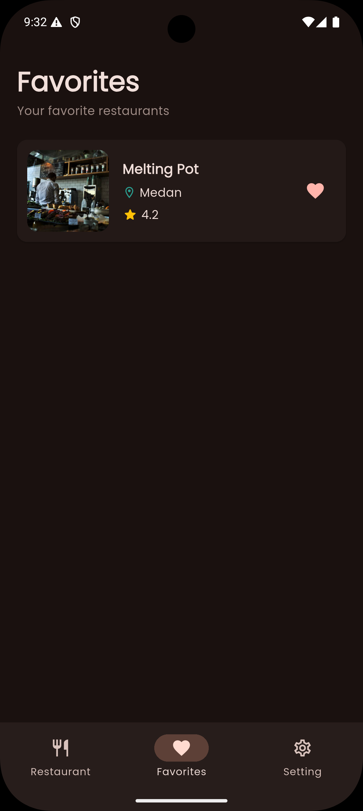
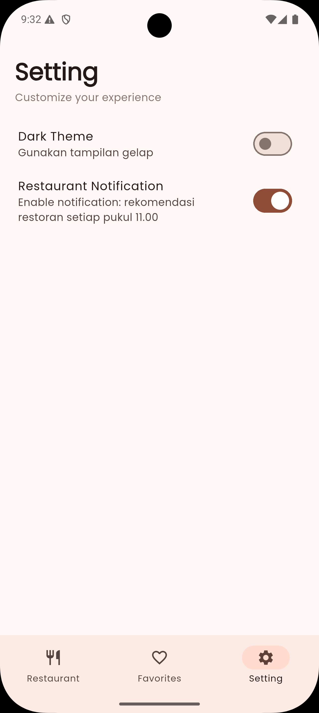

# 🍔 Favorite Restaurant App - Dicoding Final Submission

Aplikasi mobile berbasis **Flutter** tingkat lanjut yang merupakan pengembangan dari proyek Restaurant App sebelumnya. Proyek ini menambahkan fitur penyimpanan lokal reaktif untuk daftar favorit menggunakan **SQLite**, manajemen persistensi tema & reminder via **Shared Preferences**, penjadwalan latar belakang (*Background Scheduler*) menggunakan **Workmanager**, serta diuji secara komprehensif menggunakan cakupan **Automated Testing**.

Aplikasi ini menerapkan standar kode bersih (Clean Code), arsitektur terpisah, dan bebas dari error overflow visual.

---

## ✨ Fitur Utama & Kriteria Kelulusan (Final Update)

### 🧱 Kriteria Wajib Baru (Submission Final)
- **Halaman Favorit Restoran**: Halaman khusus yang menampilkan daftar restoran yang ditandai sebagai favorit secara instan tanpa duplikasi data.
- **Penyimpanan Lokal SQLite**: Menggunakan database lokal **SQLite** (`sqflite`) sebagai sumber kebenaran tunggal (*single source of truth*) data favorit dengan `id` restoran diatur sebagai `PRIMARY KEY`.
- **Pengaturan Tema Terstruktur**: Menu khusus untuk beralih antara *Light Theme* dan *Dark Theme* secara instan.
- **Persistensi State via Shared Preferences**: Menyimpan status tema dan status *Daily Reminder* menggunakan **Shared Preferences** agar konfigurasi tidak hilang saat aplikasi ditutup total (*cold boot*).
- **Fitur Pengaturan Daily Reminder**: Opsi untuk mengaktifkan notifikasi pengingat makan siang yang dijadwalkan secara berkala di halaman pengaturan.
- **Automated Testing Komprehensif**: Menerapkan pengujian unit (*Unit Testing*) menggunakan paket `mocktail` untuk menguji kondisi awal provider, kondisi sukses muat data API, dan kondisi gagal muat data API secara terisolasi.

### 🌟 Fitur Tambahan (Strategi Nilai Bintang 5)
- **Modifikasi Notifikasi Daily Reminder Acak**: Mengintegrasikan **Workmanager** dan **Flutter Local Notifications** untuk menembak API Dicoding secara langsung di latar belakang tepat pukul 11:00 AM, mengacak pilihan restoran memakai fungsi `Random`, dan memunculkan namanya secara dinamis di banner notifikasi HP.
- **Aliran Data Reaktif Bebas Flicker**: Inisialisasi *Shared Preferences* dimuat langsung di dalam fungsi `main()` sebelum `runApp()`, menjamin layar mode gelap tidak mengalami kedipan putih saat aplikasi dibuka dari kondisi mati.

---

## 📸 Cuplikan Aplikasi Terbaru

<table align="center">
  <tr>
    <td align="center"><b>Daftar Restoran (Light)</b></td>
    <td align="center"><b>Detail Restoran (Dark)</b></td>
    <td align="center"><b>Restoran Favorit (Dark)</b></td>
    <td align="center"><b>Menu Pengaturan (Dark)</b></td>
  </tr>
  <tr>
    <td></td>
    <td></td>
    <td></td>
    <td></td>
  </tr>
</table>

---

## 📂 Struktur Direktori Proyek Terkini (Arsitektur Bersih)

Proyek ini telah direstrukturisasi secara modular untuk mendukung perluasan data lokal, data preferensi, serta folder pengujian terpisah:

```text
lib/
├── data/
│   ├── api/              # Layanan HTTP Client ke Dicoding API
│   │   ├── api_exception.dart
│   │   └── api_service.dart
│   ├── database/         # Konfigurasi Database Lokal SQLite (Anti-Duplikat)
│   │   └── database_helper.dart
│   ├── preferences/      # Utilitas Penyimpanan Key-Value Shared Preferences
│   │   └── preferences_helper.dart
│   ├── background/       # Background Worker & Scheduler Layar Belakang
│   │   └── background_service.dart
│   ├── notification/     # Konfigurasi Banner Notifikasi Sistem OS
│   │   └── notification_helper.dart
│   └── models/           # Objek Model Data (JSON & Map Parsing)
│       ├── restaurant.dart
│       ├── restaurant_detail.dart
│       └── customer_review.dart
├── providers/            # State Management & Logika Bisnis (ChangeNotifier)
│   ├── restaurant_list_provider.dart
│   ├── restaurant_detail_provider.dart
│   ├── favorite_provider.dart
│   └── settings_provider.dart
├── static/               # Pengaturan Tema Kustom & Sealed Class State
│   ├── app_theme.dart
│   └── result_state.dart
├── ui/
│   ├── screens/          # Layar Visual Antarmuka Utama Aplikasi
│   │   ├── home_screen.dart        # Navigasi Bawah (List, Favorite, Settings)
│   │   ├── restaurant_list_screen.dart
│   │   ├── restaurant_detail_screen.dart
│   │   ├── favorite_screen.dart
│   │   └── settings_screen.dart
│   └── widgets/          # Komponen UI Reusable
│       ├── restaurant_card.dart
│       ├── empty_view.dart
│       └── loading_indicator.dart
└── main.dart             # Titik Inisialisasi Utama Aplikasi (Bebas Flicker)

test/                     # DIREKTORI AUTOMATED TESTING (Wajib Sesuai Kriteria)
└── providers/
    └── restaurant_list_provider_test.dart  # Unit Test Menggunakan Mocktail
```

---

## 🛠️ Panduan Menjalankan Aplikasi & Tes Otomatis

### 1. Sinkronisasi Library Terbaru
Buka terminal proyek Anda, lalu unduh paket dependensi SQLite, Shared Preferences, Workmanager, dan Mocktail yang terdaftar di `pubspec.yaml`:
```bash
flutter pub get
```

### 2. Menjalankan Automated Testing (Pengujian Otomatis)
Guna memvalidasi kebenaran logika provider saat mengambil data dari API (Skenario: *Initial State*, *Success State*, dan *Error State*), jalankan perintah pengujian berikut:
```bash
flutter test
```
*Pastikan terminal menampilkan output hijau `All tests passed!` untuk menjamin kelulusan pengujian.*

### 3. Membersihkan dan Membungkus Berkas Proyek (Sebelum di-Submit)
Sebelum mengompres folder proyek menjadi format berkas **ZIP** untuk diunggah ke platform Dicoding, jalankan perintah ini untuk menghapus folder sampah otomatis `build/` agar ukuran berkas ZIP menjadi sangat kecil (di bawah 25 MB):
```bash
flutter clean
```
*Catatan: Jangan menjalankan perintah `flutter run` atau membuka emulator lagi setelah proses cleaning selesai dilakukan.*

---

## 🌐 Informasi Referensi Endpoint API
Aplikasi ini berkomunikasi secara asinkronus ke server menggunakan **Dicoding Restaurant API**:
- **Daftar Restoran**: `GET https://dicoding.dev`
- **Detail Restoran**: `GET https://dicoding.dev{id}`
- **Pencarian Restoran**: `GET https://dicoding.dev{query}`
- **Tambah Ulasan**: `POST https://dicoding.dev`
